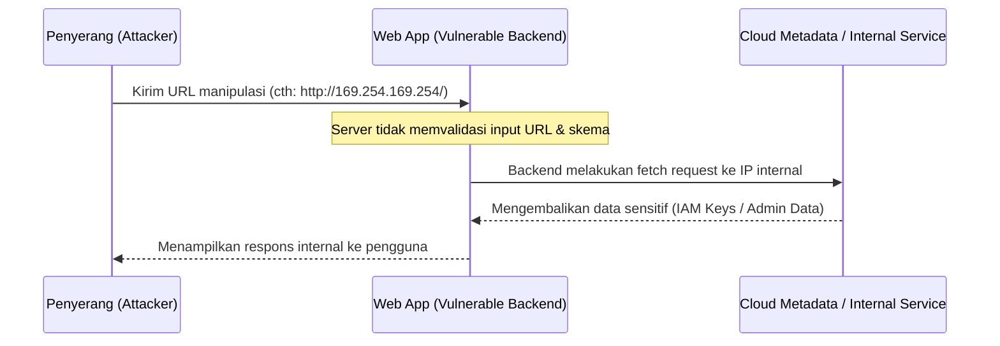

# Vulnerability Research: Server-Side Request Forgery (SSRF)

## 1. Overview & Impact

* **Vulnerability Type:** Server-Side Request Forgery (SSRF) [OWASP A10 / Server-Side Flaws]
* **Severity:** High / Critical (bergantung pada arsitektur internal target)
* **Description:** SSRF terjadi ketika aplikasi web mengambil URL jarak jauh yang dikendalikan oleh pengguna tanpa melakukan validasi atau sanitasi yang memadai pada alamat tujuan (*destination IP address*).
* **Impact:**
* Akses ke layanan internal yang terlindung di balik *firewall* (Internal Microservices, Admin Panels).
* Ekstraksi metadata *cloud instance* (AWS/GCP/Azure) yang berisi kredensial IAM sementara.
* Pemindaian port internal (*Internal Port Scanning*) dan potensi eksekusi perintah melalui protokol sekunder seperti `gopher://` atau `dict://`.

---

## 2. Attack Flow Architecture



---

## 3. Code Comparison: Vulnerable vs Secure Implementation

### ❌ Vulnerable Implementation (Java / Spring Boot)

```java
@GetMapping("/fetch")
public ResponseEntity<String> fetchUrl(@RequestParam String targetUrl) throws IOException {
    // BERBAHAYA: Mengambil URL langsung dari input pengguna tanpa allowlist atau blokir IP privat
    URL url = new URL(targetUrl);
    HttpURLConnection connection = (HttpURLConnection) url.openConnection();
    BufferedReader reader = new BufferedReader(new InputStreamReader(connection.getInputStream()));
    
    StringBuilder response = new StringBuilder();
    String line;
    while ((line = reader.readLine()) != null) {
        response.append(line);
    }
    reader.close();
    return ResponseEntity.ok(response.toString());
}

```

### ✅ Secure Implementation & Mitigation (Java / Spring Boot)

```java
@GetMapping("/fetch")
public ResponseEntity<String> fetchUrlSecure(@RequestParam String targetUrl) {
    try {
        URI uri = URI.create(targetUrl);
        
        // 1. Validasi Protokol (Hanya izinkan HTTP dan HTTPS)
        String scheme = uri.getScheme();
        if (scheme == null || (!scheme.equalsIgnoreCase("http") && !scheme.equalsIgnoreCase("https"))) {
            return ResponseEntity.status(HttpStatus.BAD_REQUEST).body("Invalid protocol. Only HTTP/HTTPS allowed.");
        }
        
        // 2. Resolusi DNS & Validasi IP untuk mencegah akses Loopback / Private IP / Cloud Metadata
        InetAddress address = InetAddress.getByName(uri.getHost());
        if (address.isLoopbackAddress() || address.isSiteLocalAddress() || address.isLinkLocalAddress() || address.isAnyLocalAddress()) {
            return ResponseEntity.status(HttpStatus.FORBIDDEN).body("Access to internal IP ranges is strictly blocked.");
        }
        
        // Lanjutkan fetch aman menggunakan RestTemplate / HttpClient dengan konfigurasi timeout & redirect policy ketat...
        return ResponseEntity.ok("URL successfully validated and fetched securely.");
        
    } catch (Exception e) {
        return ResponseEntity.status(HttpStatus.BAD_REQUEST).body("Invalid URL or resolution failed.");
    }
}

```

---

## 4. Key Defense Strategies (Pencegahan)

1. **Strict URL Schema Validation:** Batasi protokol yang diperbolehkan hanya `http://` dan `https://`. Blokir protokol berbahaya seperti `file://`, `gopher://`, atau `dict://`.
2. **Network Segmentation & Firewall:** Isolasi server backend agar tidak memiliki akses langsung ke endpoint metadata cloud (`169.254.169.254`) atau jaringan internal kecuali benar-benar dibutuhkan.
3. **Allowlisting Approach:** Gunakan daftar domain yang diizinkan (*domain allowlist*) ketimbang membiarkan pengguna memasukkan URL bebas.
4. **Disable HTTP Redirects:** Cegah aplikasi mengikuti *redirect* otomatis secara membabi buta guna menghindari teknik *DNS Rebinding* atau pembelokan URL ke IP internal.
