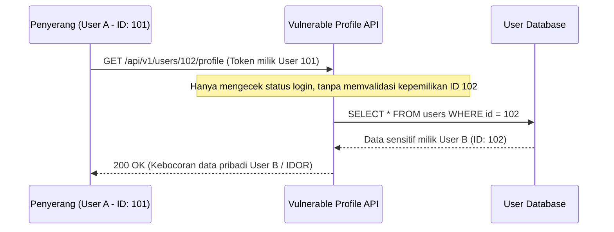

# Vulnerability Research: Broken Access Control

## 1. Overview & Impact

* **Vulnerability Type:** Broken Access Control (OWASP A01)

* **Severity:** High / Critical

* **Description:** Broken Access Control occurs when an application fails to properly enforce restrictions on what authenticated or unauthenticated users are allowed to do. Attackers can exploit these flaws to access unauthorized functionality and/or data, such as accessing other users' accounts, viewing sensitive files, modifying other users' data, or changing access rights.

* **Impact:**

  * **Unauthorized Data Disclosure:** Attackers access sensitive records belonging to other users via Insecure Direct Object References (IDOR) or missing function-level access control.

  * **Privilege Escalation:** Standard users elevate their privileges to administrative roles by tampering with request parameters, JWT claims, or bypassing API gateway checks.

  * **Unauthorized Data Modification & Destruction:** Attackers alter, create, or delete critical business records without proper ownership validation.

## 2. Attack Architecture (Mermaid Diagram)



## 3. Common Weaknesses & Misconfigurations

1. **Insecure Direct Object References (IDOR):** Exposing internal object identifiers (such as database primary keys) in URLs or request bodies without verifying whether the requesting user owns or has permission to access the target resource.

2. **Missing Function-Level Access Control:** Relying solely on hiding administrative UI elements on the frontend while leaving backend administrative API endpoints accessible to regular authenticated users.

3. **Metadata & Token Manipulation:** Trusting client-supplied role parameters, cookies, or improperly verified JWT tokens (e.g., accepting `alg: none` or unsigned tokens) to determine user authorization levels.

## 4. Code Comparison: Vulnerable vs Secure Implementation (Java Spring Boot)

### ❌ Vulnerable Implementation

```java
// BERBAHAYA: Rentan terhadap IDOR karena tidak memverifikasi kepemilikan resource
@GetMapping("/api/v1/users/{userId}/profile")
public ResponseEntity<UserProfileDTO> getUserProfile(@PathVariable Long userId) {
    // Langsung mengambil data berdasarkan path variable tanpa mengecek siapa yang sedang login
    User user = userRepository.findById(userId)
        .orElseThrow(() -> new ResourceNotFoundException("User not found"));
        
    return ResponseEntity.ok(UserProfileDTO.from(user));
}
```

### ✅ Secure Implementation & Mitigation

```java
// AMAN: Memvalidasi kepemilikan resource & menerapkan Role-Based Access Control (RBAC)
@GetMapping("/api/v1/users/{userId}/profile")
@PreAuthorize("hasRole('ADMIN') or #userId == authentication.principal.id")
public ResponseEntity<UserProfileDTO> getUserProfileSecure(
        @PathVariable Long userId,
        @AuthenticationPrincipal CustomUserDetails currentUser) {
    
    // Double-check kepemilikan di level service/controller untuk prinsip Defense in Depth
    if (!currentUser.isAdmin() && !currentUser.getId().equals(userId)) {
        securityLogger.warn("SECURITY_EVENT=UNAUTHORIZED_ACCESS_ATTEMPT actorId={} targetId={}", 
            currentUser.getId(), userId);
        throw new AccessDeniedException("You do not have permission to access this profile.");
    }

    User user = userRepository.findById(userId)
        .orElseThrow(() -> new ResourceNotFoundException("User not found"));
        
    return ResponseEntity.ok(UserProfileDTO.from(user));
}
```

## 5. Key Defense Strategies

* **Enforce Deny-by-Default Access Policies:** Configure authorization rules so that all endpoints and resources deny access by default unless explicitly permitted for a specific role or owner.

* **Implement Server-Side Ownership & RBAC Checks:** Validate user permissions and resource ownership on every server-side request using centralized authorization frameworks (such as Spring Security `@PreAuthorize`), rather than relying on client-side controls.

* **Use Non-Sequential & Unpredictable Identifiers:** Replace sequential numeric database IDs with UUIDs or indirect reference maps where appropriate, combined with strict server-side authorization checks.
