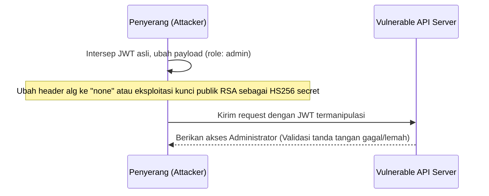

# Vulnerability Research: JWT (JSON Web Token) Misconfigurations & Broken Authentication

## 1. Overview & Impact
* **Vulnerability Type:** Cryptographic Failures & Broken Authentication (OWASP A02 / A07)
* **Severity:** High / Critical
* **Description:** JSON Web Tokens (JWT) are widely used for stateless session management and authentication. However, improper configuration, weak secrets, or flawed signature verification logic can allow attackers to forge tokens, bypass authentication, and elevate privileges.
* **Impact:** 
  * Full account takeover by modifying claims (e.g., changing `role: user` to `role: admin`).
  * Bypass of authentication checks entirely.
  * Information disclosure through unencrypted payload decoding.

---

## 2. Attack Architecture (Mermaid Diagram)



---

## 3. Common Misconfigurations
1. **The `none` Algorithm Vulnerability:** Accepting tokens where the header specifies `"alg": "none"`, bypassing signature verification completely.
2. **Algorithm Confusion (RS256 to HS256):** The application uses an asymmetric public key (`public key`) to verify tokens, but a flaw allows attackers to sign malicious tokens using the public key as a symmetric HMAC secret (`HS256`).
3. **Weak Secret Brute-Forcing:** Using short, predictable, or dictionary-based secrets for `HS256` signing, enabling offline brute-force cracking using tools like `jwt_tool` or Hashcat.

---

## 4. Code Comparison: Vulnerable vs Secure Implementation (Java Spring Boot)

### ❌ Vulnerable Implementation
```java
// BERBAHAYA: Tidak memvalidasi algoritma secara ketat atau menerima argumen parsial yang tidak aman
Claims claims = Jwts.parser()
    .setSigningKey(secretKey)
    .parseClaimsJws(token)
    .getBody();
```

### ✅ Secure Implementation & Mitigation
```java
// AMAN: Membatasi algoritma secara eksplisit (misal: hanya HS256) dan memvalidasi struktur serta kedaluwarsa token
Jws<Claims> claims = Jwts.parserBuilder()
    .setSigningKey(secretKey)
    .requireIssuer("your-trusted-issuer")
    .build()
    .parseClaimsJws(token);
    
// Ekstrak klaim dengan aman setelah tanda tangan terverifikasi secara kriptografis
String userRole = claims.getBody().get("role", String.class);
```

---

## 5. Key Defense Strategies
* **Enforce Strict Algorithm Whitelisting:** Never allow `none` or dynamic algorithm selection supplied by the client header. Explicitly configure the parser to expect only one specific algorithm (e.g., `HS256` or `RS256`).
* **Use Strong, Cryptographically Secure Secrets:** Ensure HMAC secrets are at least 256 bits long and generated using secure pseudo-random number generators.
* **Proper Key Management:** Keep asymmetric private keys strictly confidential and ensure public keys cannot be repurposed as HMAC verification secrets.