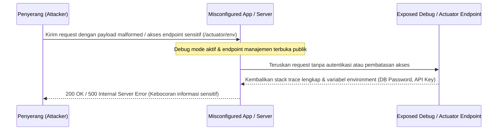

# Vulnerability Research: Security Misconfiguration

## 1. Overview & Impact

* **Vulnerability Type:** Security Misconfiguration (OWASP A05)

* **Severity:** High

* **Description:** Security misconfiguration occurs when security settings are not defined, implemented, or maintained properly across any level of an application stack (network services, platform, web server, application server, database, frameworks, and custom code). This often happens when default configurations, incomplete setups, open cloud storage, or verbose error messages are left exposed in production.

* **Impact:**

  * **Unauthorized System Access:** Attackers gain access to administrative consoles, cloud buckets, or internal services using unchanged default credentials or exposed management ports.

  * **Sensitive Information Disclosure:** Stack traces, debug logs, directory listings, or misconfigured CORS headers leak internal architecture details, environment variables, and user data.

  * **Full Server Compromise:** Unpatched services or unnecessary active features (ports, services, pages, accounts, or privileges) provide an easy foothold for remote code execution.

## 2. Attack Architecture (Mermaid Diagram)



## 3. Common Weaknesses & Misconfigurations

1. **Exposed Debug Features & Management Endpoints:** Leaving debug mode enabled (`server.error.include-stacktrace=always`) or exposing Spring Boot Actuator endpoints (`/actuator/env`, `/actuator/heapdump`) to the public internet without authentication.

2. **Default Accounts & Unchanged Passwords:** Keeping default administrative credentials (e.g., `admin/admin`), sample applications, or default database configurations active in production environments.

3. **Permissive CORS & Missing Security Headers:** Configuring overly broad Cross-Origin Resource Sharing (`Access-Control-Allow-Origin: *` with credentials) or omitting critical HTTP security headers (`Strict-Transport-Security`, `Content-Security-Policy`, `X-Frame-Options`).

## 4. Code Comparison: Vulnerable vs Secure Implementation (Java Spring Boot)

### ❌ Vulnerable Implementation

```java
// BERBAHAYA: Mengizinkan semua origin pada CORS, menonaktifkan CSRF, dan mengekspos detail error
@Configuration
@EnableWebSecurity
public class InsecureSecurityConfig {

    @Bean
    public SecurityFilterChain filterChain(HttpSecurity http) throws Exception {
        http
            .csrf(csrf -> csrf.disable()) // CSRF dimatikan secara global tanpa alasan jelas
            .cors(cors -> cors.configurationSource(request -> {
                CorsConfiguration config = new CorsConfiguration();
                config.setAllowedOrigins(List.of("*")); // Terlalu permisif: semua domain diizinkan
                config.setAllowedMethods(List.of("*"));
                return config;
            }))
            .authorizeHttpRequests(auth -> auth
                .requestMatchers("/actuator/**").permitAll() // Endpoint sensitif terbuka untuk publik!
                .anyRequest().authenticated()
            );
        return http.build();
    }
}
```

### ✅ Secure Implementation & Mitigation

```java
// AMAN: Membatasi CORS hanya pada domain tepercaya, mengamankan endpoint actuator, & menambahkan security headers
@Configuration
@EnableWebSecurity
public class SecureSecurityConfig {

    @Bean
    public SecurityFilterChain filterChain(HttpSecurity http) throws Exception {
        http
            .cors(cors -> cors.configurationSource(request -> {
                CorsConfiguration config = new CorsConfiguration();
                config.setAllowedOrigins(List.of("https://app.example.com")); // Hanya domain resmi
                config.setAllowedMethods(List.of("GET", "POST", "PUT", "DELETE"));
                config.setAllowCredentials(true);
                return config;
            }))
            .headers(headers -> headers
                .contentSecurityPolicy(csp -> csp.policyDirectives("default-src 'self'"))
                .frameOptions(frame -> frame.deny()) // Cegah Clickjacking
            )
            .authorizeHttpRequests(auth -> auth
                .requestMatchers("/actuator/health").permitAll()
                .requestMatchers("/actuator/**").hasRole("ADMIN") // Batasi akses actuator hanya untuk ADMIN
                .anyRequest().authenticated()
            );
        return http.build();
    }
}
```

## 5. Key Defense Strategies

* **Implement Hardening & Minimalist Architecture:** Remove unnecessary features, components, files, and documentation, and disable unused ports or services across all environments.

* **Automate Configuration Verification & Patching:** Use Infrastructure as Code (IaC) templates and automated security scanners in CI/CD pipelines to detect configuration drift, exposed secrets, and missing security headers.

* **Enforce Proper Error Handling & Header Hardening:** Suppress detailed stack traces in production responses and enforce strict HTTP security headers (`CSP`, `HSTS`, `X-Content-Type-Options`) alongside restrictive CORS policies.
