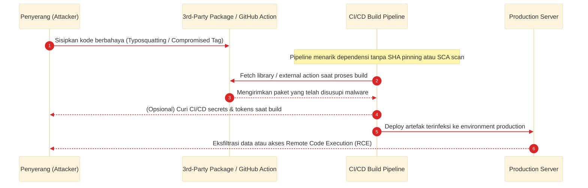
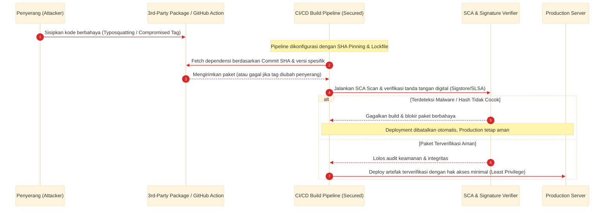

# Vulnerability Research: Software Supply Chain Failures

## 1. Overview & Impact
* **Vulnerability Type:** Software Supply Chain Failures / Vulnerable & Outdated Components (OWASP A03)
* **Severity:** High / Critical
* **Description:** Modern applications heavily rely on third-party libraries, open-source packages, and automated CI/CD pipelines. Supply chain failures occur when attackers compromise these upstream dependencies, build environments, or deployment artifacts due to lack of integrity verification, unpinned versions, or unmonitored CVEs.
* **Impact:** 
  * Remote Code Execution (RCE) on production servers via vulnerable third-party libraries (e.g., Log4Shell).
  * Unauthorized backdoor injection directly into compiled application binaries or container images.
  * Exfiltration of CI/CD environment secrets, cloud credentials, and signing keys.

---

Berikut adalah dokumentasi lengkap beserta satu paragraf deskripsi berbahasa Inggris untuk masing-masing diagram tanpa mengubah kode Mermaid Anda:

## 2. Attack Architecture


### Vulnerable Architecture

This sequence diagram illustrates a Software Supply Chain attack (OWASP A03) exploiting an unsecured CI/CD build pipeline. An attacker initially injects malicious code into a third-party package registry or compromises an existing GitHub Action tag. Because the CI/CD pipeline fetches external dependencies without enforcing SHA pinning or Software Composition Analysis (SCA) scanning, it unknowingly pulls the compromised package during the build phase. This allows the malicious payload to potentially exfiltrate sensitive CI/CD secrets immediately or get packaged into the final build artifact, ultimately deploying infected code to the production server and granting the attacker unauthorized Remote Code Execution (RCE) and data access.


### Secure Architecture

This sequence diagram demonstrates a hardened CI/CD pipeline designed to mitigate Software Supply Chain risks through strict dependency verification and integrity controls. Even if an attacker compromises a public package tag, the secured pipeline prevents automatic ingestion by enforcing immutable commit SHA pinning and strict lockfiles. Before compilation, all retrieved dependencies undergo automated Software Composition Analysis (SCA) and cryptographic signature verification (such as Sigstore or SLSA). If malware or a hash mismatch is detected, the pipeline triggers a fail-closed response that immediately halts the build and blocks deployment, ensuring only verified artifacts are deployed to production under strict least-privilege permissions.



## 3. Common Misconfigurations
1. **Unpinned Third-Party CI/CD Actions:** Referencing mutable branch names or major version tags (e.g., `@v4` or `@main`) in GitHub Actions workflows instead of immutable commit hashes, allowing attackers to silently alter action behavior if the upstream repository is compromised.
2. **Missing Software Composition Analysis (SCA):** Failing to automatically scan project manifests (`pom.xml`, `build.gradle`, `package.json`, `pubspec.yaml`) for known vulnerabilities (CVEs) before merging code.
3. **Dependency Confusion & Missing Lockfiles:** Omitting lockfiles (`gradle.lockfile`, `package-lock.json`) or failing to scope private package namespaces, allowing public malicious packages with identical names to override internal dependencies.

---

## 4. Code Comparison: Vulnerable vs Secure Implementation (CI/CD & Maven)

### Vulnerable Implementation
```yaml
# BERBAHAYA: Menggunakan tag versi yang bisa dimanipulasi sewaktu-waktu dan tanpa pemindaian SCA
jobs:
  build:
    runs-on: ubuntu-latest
    steps:
      - uses: actions/checkout@v4
      - uses: third-party-vendor/deploy-tool@main
```

### ✅ Secure Implementation & Mitigation
```yaml
# AMAN: Mengunci aksi pihak ketiga dengan full commit SHA (immutable) dan membatasi permissions
jobs:
  build:
    runs-on: ubuntu-latest
    permissions:
      contents: read
    steps:
      - uses: actions/checkout@b4ffde65f46336ab88eb53be808477a3936bae11 # v4.1.1
      - uses: third-party-vendor/deploy-tool@9f8e7d6c5b4a3f2e1d0c9b8a7f6e5d4c3b2a1f0e # v2.1.0
```

---

## 5. Key Defense Strategies
* **Enforce Commit SHA Pinning:** Always pin external GitHub Actions and container base images to a specific, immutable cryptographic digest or commit SHA rather than mutable tags.
* **Integrate Automated SCA & SBOM Generation:** Embed tools like Trivy, Snyk, or OWASP Dependency-Check into the CI/CD pipeline to block builds containing critical CVEs and generate a Software Bill of Materials (SBOM).
* **Strict Lockfile & Private Registry Scoping:** Enforce deterministic builds using committed lockfiles and configure package managers to strictly resolve internal namespaces from private artifact repositories.