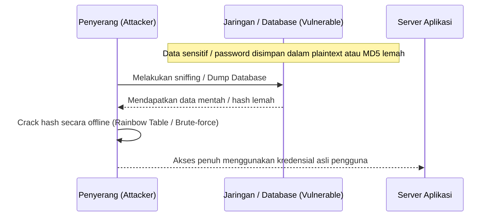

# Vulnerability Research: Cryptographic Failures

## 1. Overview & Impact
* **Vulnerability Type:** Cryptographic Failures / Insecure Data Storage & Transmission (OWASP A02)
* **Severity:** High / Critical
* **Description:** Cryptographic failures occur when sensitive data (such as passwords, credit cards, PII, or API keys) is transmitted or stored without adequate encryption, or when weak/outdated cryptographic algorithms and improper key management practices are used.
* **Impact:** 
  * Mass exposure of sensitive user data and credentials via plaintext storage or insecure transmission.
  * Easy ciphertext decryption due to legacy/weak algorithms (e.g., MD5, SHA-1, DES).
  * Session hijacking or data tampering due to missing or weak transport layer security (TLS).

---

## 2. Attack Architecture (Mermaid Diagram)



---

## 3. Common Weaknesses & Misconfigurations
1. **Plaintext Storage of Sensitive Data:** Storing passwords, credit card numbers, or API secrets directly in plaintext within databases or configuration files.
2. **Use of Deprecated/Broken Hash Algorithms:** Using un-salted hashing algorithms like MD5, SHA-1, or fast hashing without work factors (like plain SHA-256) for password storage, making them trivial to crack via rainbow tables.
3. **Insecure Random Number Generators (RNG):** Using standard pseudo-random number generators (`java.util.Random`) for security-sensitive tokens, session IDs, or cryptographic keys instead of cryptographically secure alternatives (`SecureRandom`).

---

## 4. Code Comparison: Vulnerable vs Secure Implementation (Java Spring Boot)

### ❌ Vulnerable Implementation
```java
// BERBAHAYA: Menggunakan MD5 atau SHA-256 murni tanpa salt untuk password (rentan di-crack)
MessageDigest md = MessageDigest.getInstance("MD5");
byte[] hashBytes = md.digest(password.getBytes(StandardCharsets.UTF_8));
String weakHash = bytesToHex(hashBytes); 
userRepository.save(new User(username, weakHash)); // Sangat mudah dibobol
```

### ✅ Secure Implementation & Mitigation
```java
// AMAN: Menggunakan fungsi hashing adaptif yang kuat (BCrypt) dengan salt otomatis
BCryptPasswordEncoder passwordEncoder = new BCryptPasswordEncoder();
String secureHashedPassword = passwordEncoder.encode(rawPassword);

user.setPassword(secureHashedPassword);
userRepository.save(user);

// Verifikasi password aman
boolean matches = passwordEncoder.matches(rawPassword, user.getPassword());
```

---

## 5. Key Defense Strategies
* **Classify and Encrypt Data at Rest:** Identify sensitive data elements and encrypt them using modern, robust ciphers (e.g., AES-GCM-256) with securely managed keys (Key Management Service / KMS).
* **Enforce Strong Transport Layer Security (TLS):** Ensure all data *in transit* is encrypted using strong TLS configurations (TLS 1.2 / TLS 1.3) with secure cipher suites, redirecting all HTTP traffic to HTTPS.
* **Use Adaptive Hashing for Passwords:** Never use general-purpose hashing functions (like SHA-256) for passwords. Use adaptive, slow hashing functions designed specifically for passwords like **Argon2**, **bcrypt**, or **PBKDF2** with built-in work factors and salting.