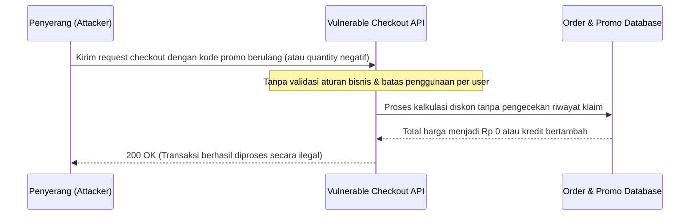

# Vulnerability Research: Insecure Design

## 1. Overview & Impact

* **Vulnerability Type:** Insecure Design (OWASP A04:2021)

* **Severity:** High / Critical

* **Description:** Insecure design is a broad category representing different weaknesses, expressed as "missing or ineffective control design." It occurs when an application is built without a secure architectural foundation, lacking proper threat modeling, business logic validation, or security controls from the initial planning phase—meaning even a flawless code implementation cannot fix the underlying architectural flaw.

* **Impact:**

  * **Business Logic Bypass:** Attackers exploit missing workflow validations to manipulate pricing, claim unlimited promotional vouchers, or skip mandatory verification steps.

  * **Resource & Inventory Exhaustion:** Unbounded resource allocation allows malicious actors to hoard limited inventory (e.g., ticket scalping) or exhaust system storage and bandwidth without restriction.

  * **Unauthorized Privilege or Data Exposure:** Flawed multi-tenant isolation or weak recovery designs allow users to access cross-tenant resources or reset credentials via predictable security questions.

## 2. Attack Architecture (Mermaid Diagram)



## 3. Common Weaknesses & Misconfigurations

1. **Missing Business Logic & Workflow Limits:** Failing to enforce limits on transactions, promotional redemptions, or sequential step completions (e.g., allowing a user to jump directly to the payment confirmation endpoint).

2. **Weak Account Recovery Design:** Relying on easily guessable or publicly discoverable "security questions" (e.g., mother's maiden name, favorite color) instead of cryptographic token-based recovery flows.

3. **Lack of Tenant Segregation & Resource Quotas:** Designing multi-tenant systems without strict architectural tenant boundaries or failing to restrict file upload sizes, API consumption quotas, and seat reservations per user.

## 4. Code Comparison: Vulnerable vs Secure Implementation (Java Spring Boot)

### ❌ Vulnerable Implementation

```java
// BERBAHAYA: Desain bisnis tidak memvalidasi kepemilikan promo, batas pemakaian, atau nilai negatif
@PostMapping("/api/v1/orders/checkout")
public ResponseEntity<String> checkout(@RequestBody OrderRequest request) {
    double totalPrice = request.getUnitPrice() * request.getQuantity(); // Rentan manipulasi harga & quantity negatif dari client
    
    if (request.getPromoCode() != null) {
        Promo promo = promoRepository.findByCode(request.getPromoCode());
        if (promo != null) {
            totalPrice -= promo.getDiscountAmount(); // Tidak mengecek apakah user sudah pernah memakai promo ini
        }
    }
    
    orderService.createOrder(request.getUserId(), totalPrice);
    return ResponseEntity.ok("Order processed. Total: " + totalPrice);
}
```

### ✅ Secure Implementation & Mitigation

```java
// AMAN: Menerapkan server-side pricing, validasi batas kuota promo per user, & pencegahan nilai negatif
@PostMapping("/api/v1/orders/checkout")
public ResponseEntity<Map<String, Object>> checkoutSecure(
        @Valid @RequestBody OrderRequest request,
        Authentication authentication) {
    
    String userId = authentication.getName();
    
    // 1. Validasi aturan bisnis dasar (Quantity harus positif)
    if (request.getQuantity() <= 0 || request.getQuantity() > 10) {
        return ResponseEntity.badRequest()
            .body(Map.of("error", "Invalid item quantity requested."));
    }
    
    // 2. Ambil harga asli dari server (jangan percaya harga dari client)
    Product product = productRepository.findById(request.getProductId())
        .orElseThrow(() -> new IllegalArgumentException("Product not found"));
    BigDecimal totalPrice = product.getPrice().multiply(BigDecimal.valueOf(request.getQuantity()));
    
    // 3. Validasi penggunaan promo secara atomik agar tidak bisa diklaim berulang
    if (request.getPromoCode() != null) {
        BigDecimal discount = promoService.validateAndLockPromo(request.getPromoCode(), userId);
        totalPrice = totalPrice.subtract(discount).max(BigDecimal.ZERO);
    }
    
    Order order = orderService.createOrder(userId, product.getId(), request.getQuantity(), totalPrice);
    return ResponseEntity.ok(Map.of("orderId", order.getId(), "finalTotal", totalPrice));
}
```

## 5. Key Defense Strategies

* **Integrate Threat Modeling Early:** Conduct structured threat modeling (such as STRIDE) during the architectural and specification phases to identify business logic abuses before writing code.

* **Enforce Server-Side Business Invariants:** Never trust client-supplied prices, roles, or workflow states; enforce strict domain rules, atomic quota checks, and positive value constraints at the service and database layers.

* **Adopt Secure Design Patterns & Reference Architectures:** Utilize proven security patterns (e.g., cryptographic one-time recovery links instead of knowledge-based questions, strict tenant isolation, and per-user resource caps) across all application modules.
