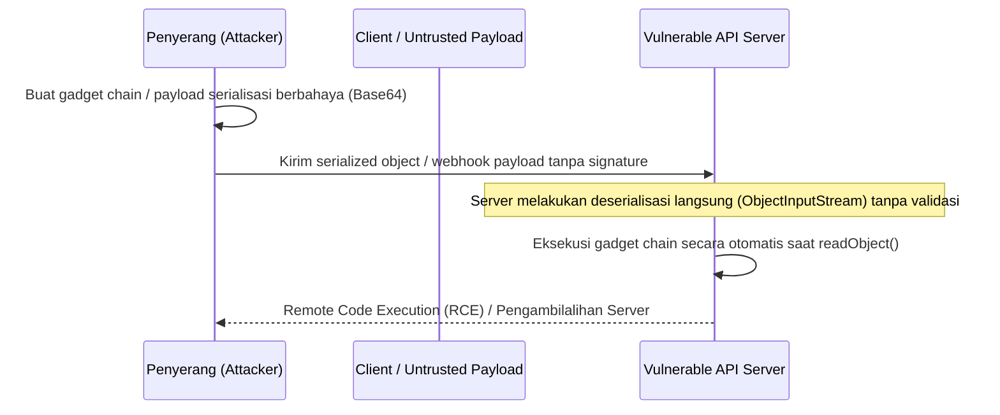

# Vulnerability Research: Software and Data Integrity Failures

## 1. Overview & Impact

* **Vulnerability Type:** Software and Data Integrity Failures / Insecure Deserialization (OWASP A08)
* **Severity:** High / Critical
* **Description:** Software and data integrity failures relate to code and infrastructure that do not protect against integrity violations. This occurs when an application relies upon plugins, libraries, or modules from untrusted sources, repositories, or CDNs without integrity verification, or when untrusted data is deserialized or processed without cryptographic signature checks.
* **Impact:**
  * **Remote Code Execution (RCE):** Exploiting insecure deserialization of untrusted objects to execute arbitrary code on the application server.
  * **Unauthorized Privilege Escalation & Tampering:** Modifying client-side serialized state, cookies, or webhook payloads when no HMAC signature or integrity verification is enforced.
  * **Malicious Code Execution in Client Browsers:** Loading compromised third-party scripts from external CDNs without Subresource Integrity (SRI) hashes.

---

## 2. Attack Architecture (Mermaid Diagram)



---

## 3. Common Weaknesses & Misconfigurations

1. **Insecure Deserialization of Untrusted Data:** Using native serialization mechanisms (such as Java's `ObjectInputStream.readObject()`) on user-controlled input, allowing attackers to leverage classpath gadget chains for RCE.
2. **Unverified Webhooks & State Payloads:** Accepting critical state updates (e.g., payment gateway webhooks) or client-side state objects without verifying cryptographic HMAC signatures.
3. **Missing Subresource Integrity (SRI) & Update Verification:** Loading external JavaScript libraries from public CDNs without `integrity` hashes, or deploying auto-updates without verifying digital signatures.

---

## 4. Code Comparison: Vulnerable vs Secure Implementation (Java Spring Boot)

### ❌ Vulnerable Implementation

```java
// BERBAHAYA: Melakukan deserialisasi langsung dari input byte stream yang dikendalikan pengguna
@PostMapping("/api/v1/import-session")
public ResponseEntity<String> importSession(@RequestBody byte[] serializedData) {
    try (ByteArrayInputStream bis = new ByteArrayInputStream(serializedData);
         ObjectInputStream ois = new ObjectInputStream(bis)) {
        
        // Rentan RCE jika attacker mengirimkan serialized gadget chain berbahaya
        Object sessionObj = ois.readObject();
        return ResponseEntity.ok("Session imported: " + sessionObj.toString());
    } catch (Exception e) {
        return ResponseEntity.status(HttpStatus.BAD_REQUEST).body("Invalid session data");
    }
}
```

### ✅ Secure Implementation & Mitigation

```java
// AMAN: Gunakan format pertukaran data murni (JSON/DTO) tanpa eksekusi kode & verifikasi HMAC signature
@PostMapping("/api/v1/import-session")
public ResponseEntity<Map<String, String>> importSessionSecure(
        @RequestHeader("X-Signature") String signature,
        @RequestBody String jsonPayload) {
    
    // 1. Verifikasi integritas payload menggunakan HMAC-SHA256 sebelum diproses
    if (!hmacVerifier.isValidSignature(jsonPayload, signature)) {
        return ResponseEntity.status(HttpStatus.UNAUTHORIZED)
            .body(Map.of("error", "Integrity check failed: Invalid signature"));
    }
    
    // 2. Parse menggunakan data-only serializer (Jackson) ke DTO yang ketat (tanpa polymorphic typing)
    SessionDTO sessionDto = objectMapper.readValue(jsonPayload, SessionDTO.class);
    return ResponseEntity.ok(Map.of("status", "Session securely imported for " + sessionDto.getUsername()));
}
```

---

## 5. Key Defense Strategies

* **Avoid Native Serialization of Untrusted Data:** Replace binary serialization (`ObjectInputStream`) with safe, data-only formats such as JSON or Protocol Buffers, and disable polymorphic type handling unless strictly allowlisted.
* **Enforce Cryptographic Integrity Checks (HMAC / Digital Signatures):** Verify HMAC-SHA256 signatures on all webhooks, serialized cookies, and state tokens, and ensure software updates or artifacts are cryptographically signed.
* **Implement Subresource Integrity (SRI) & Trusted Repositories:** Use SRI hashes (`integrity="sha384-..."`) for all external CDN assets and restrict dependencies to vetted, internal artifact repositories.