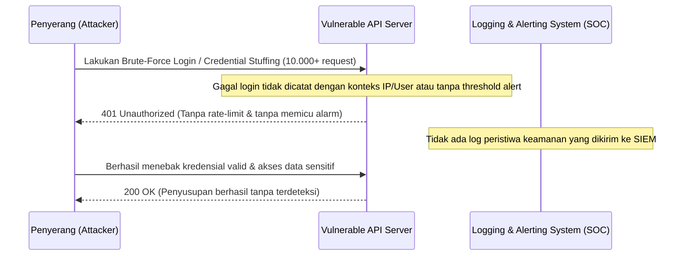

# Vulnerability Research: Security Logging and Alerting Failures

## 1. Overview & Impact

* **Vulnerability Type:** Security Logging and Monitoring Failures (OWASP A09)

* **Severity:** Medium to High

* **Description:** Security logging and alerting failures occur when an application fails to adequately record, monitor, or trigger real-time alerts for security-relevant events (such as failed login attempts, privilege changes, input validation failures, or anomalous API usage), or when logs themselves are vulnerable to injection and sensitive data leakage.

* **Impact:**

  * **Delayed Breach Detection:** Attackers can probe, brute-force, or pivot across internal systems for weeks or months without triggering any SOC/SIEM alerts.

  * **Lack of Forensic Auditability:** Incident response teams cannot trace the root cause, attack vector, or scope of compromised data after a security incident occurs.

  * **Log Injection & Sensitive Data Exposure:** Unsanitized user input in logs enables log forging (CRLF injection), while logging raw tokens or passwords leaks credentials to anyone with log access.

## 2. Attack Architecture (Mermaid Diagram)



## 3. Common Weaknesses & Misconfigurations

1. **Missing Audit Logs for Critical Events:** Auditable events such as logins, failed logins, password resets, high-value transactions, and access control failures are either not logged or lack crucial context (timestamp, source IP, user ID, correlation ID).

2. **Sensitive Data Exposure in Logs:** Accidentally writing plaintext passwords, JWTs, API keys, or Personally Identifiable Information (PII) into application log files or external monitoring aggregators.

3. **Log Injection (CRLF / Newline Forging):** Writing unsanitized user input directly into log entries, allowing attackers to inject newline characters (`\r\n`) to forge fake log entries or corrupt log parsers.

## 4. Code Comparison: Vulnerable vs Secure Implementation (Java Spring Boot)

### ❌ Vulnerable Implementation

```java
// BERBAHAYA: Logging tidak terstruktur, berpotensi Log Injection, & membocorkan data sensitif (password/token)
@PostMapping("/api/v1/login")
public ResponseEntity<String> login(@RequestBody LoginRequest request) {
    boolean authenticated = authService.authenticate(request.getUsername(), request.getPassword());
    if (!authenticated) {
        // Rentan Log Injection jika username berisi karakter newline, serta membocorkan password ke log!
        System.out.println("Failed login for user: " + request.getUsername() + " with password: " + request.getPassword());
        return ResponseEntity.status(HttpStatus.UNAUTHORIZED).body("Invalid credentials");
    }
    return ResponseEntity.ok("Login successful");
}
```

### ✅ Secure Implementation & Mitigation

```java
// AMAN: Structured logging terstandar, sanitasi input (anti-CRLF), tanpa data sensitif, & siap dikirim ke SIEM
@PostMapping("/api/v1/login")
public ResponseEntity<Map<String, String>> loginSecure(
        @RequestBody LoginRequest request,
        HttpServletRequest httpRequest) {
    
    String sanitizedUsername = request.getUsername().replaceAll("[\r\n]", "_");
    String clientIp = httpRequest.getRemoteAddr();
    
    boolean authenticated = authService.authenticate(sanitizedUsername, request.getPassword());
    if (!authenticated) {
        // Mencatat event keamanan terstruktur dengan konteks lengkap tanpa menyertakan kredensial sensitif
        securityLogger.warn("SECURITY_EVENT=FAILED_LOGIN user={} sourceIp={} userAgent={}",
                sanitizedUsername,
                clientIp,
                httpRequest.getHeader("User-Agent"));
        return ResponseEntity.status(HttpStatus.UNAUTHORIZED)
            .body(Map.of("error", "Invalid credentials"));
    }
    
    securityLogger.info("SECURITY_EVENT=SUCCESS_LOGIN user={} sourceIp={}", sanitizedUsername, clientIp);
    return ResponseEntity.ok(Map.of("status", "Login successful"));
}
```

## 5. Key Defense Strategies

* **Adopt Structured, Contextual Security Logging:** Log all authentication, authorization, and critical state-changing events in a standardized machine-readable format (e.g., JSON) containing timestamps, source IPs, user identifiers, and correlation IDs—while strictly redacting secrets, tokens, and PII.

* **Sanitize Log Inputs (Prevent Log Injection):** Strip or encode control characters (such as `\r` and `\n`) from any user-controlled data before writing it to logs to prevent log forging and parser manipulation.

* **Configure Centralized SIEM & Real-Time Threshold Alerting:** Forward logs securely to a centralized, tamper-evident SIEM/log management platform and establish automated alerting rules for anomalous patterns (e.g., repeated failed logins, privilege escalation attempts, or spikes in HTTP 403/500 responses).