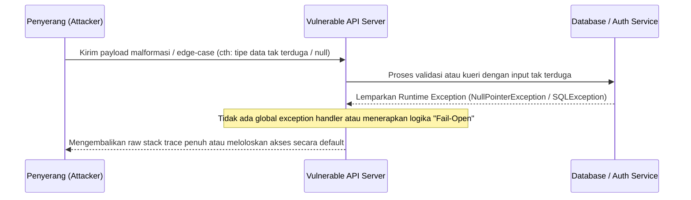

# Vulnerability Research: Mishandling of Exceptional Conditions

## 1. Overview & Impact

* **Vulnerability Type:** Improper Error Handling & Fail-Open Logic (CWE-755 / OWASP Security Misconfiguration)

* **Severity:** Medium to High

* **Description:** Mishandling of exceptional conditions occurs when an application fails to properly anticipate, catch, or handle unexpected states, runtime exceptions, or edge cases. This often leads to verbose stack trace exposure, unhandled crashes (Denial of Service), or "fail-open" security mechanisms where an error bypasses authentication or authorization checks.

* **Impact:**

  * **Information Disclosure:** Leaking internal file paths, database schemas, framework versions, or sensitive environment variables via raw stack traces.

  * **Authentication / Authorization Bypass (Fail-Open):** If a security check throws an unexpected exception and the catch block allows execution to proceed by default, attackers can intentionally trigger errors to bypass security controls.

  * **Denial of Service (DoS) & Resource Exhaustion:** Unclosed database connections, file handles, or memory leaks caused by exceptions interrupting normal cleanup routines.

## 2. Attack Architecture (Mermaid Diagram)



## 3. Common Weaknesses & Misconfigurations

1. **Verbose Stack Trace Exposure:** Returning raw exception messages, SQL syntax errors, or full stack traces directly in HTTP 500 API responses in production environments.

2. **Fail-Open Exception Handling:** Designing `try-catch` blocks around authentication, rate-limiting, or authorization checks where catching an exception accidentally grants access instead of denying it (`fail-closed`).

3. **Empty Catch Blocks & Swallowed Exceptions:** Catching critical exceptions silently without logging or alerting, masking active exploitation attempts and leaving the application in an inconsistent state.

## 4. Code Comparison: Vulnerable vs Secure Implementation (Java Spring Boot)

### ❌ Vulnerable Implementation

```java
// BERBAHAYA: Mengembalikan detail error mentah ke client & menerapkan logika "Fail-Open"
@PostMapping("/api/v1/verify-access")
public ResponseEntity<String> verifyAccess(@RequestBody AccessRequest request) {
    try {
        boolean isAuthorized = authService.checkPermission(request.getUserId(), request.getResourceId());
        if (!isAuthorized) {
            return ResponseEntity.status(HttpStatus.FORBIDDEN).body("Access Denied");
        }
    } catch (Exception e) {
        // FAIL-OPEN: Jika terjadi error (misal DB timeout/NullPointer), logika lanjut ke bawah dan memberi akses!
        e.printStackTrace(); // Mencetak stack trace tanpa struktur logging yang aman
    }
    return ResponseEntity.ok("Access Granted to Sensitive Resource");
}
```

### ✅ Secure Implementation & Mitigation

```java
// AMAN: Menerapkan prinsip "Fail-Closed", logging internal terstruktur, dan pesan error generik
@PostMapping("/api/v1/verify-access")
public ResponseEntity<Map<String, String>> verifyAccessSecure(@RequestBody AccessRequest request) {
    try {
        boolean isAuthorized = authService.checkPermission(request.getUserId(), request.getResourceId());
        if (!isAuthorized) {
            return ResponseEntity.status(HttpStatus.FORBIDDEN)
                .body(Map.of("error", "Access Denied"));
        }
        return ResponseEntity.ok(Map.of("status", "Access Granted"));
    } catch (Exception e) {
        // 1. Log detail error secara aman di sisi server (tidak dikirim ke client)
        logger.error("Authorization check failed unexpectedly for user {}: {}", request.getUserId(), e.getMessage());
        
        // 2. FAIL-CLOSED: Tolak akses secara default dan kembalikan pesan generik dengan Correlation ID
        return ResponseEntity.status(HttpStatus.INTERNAL_SERVER_ERROR)
            .body(Map.of("error", "An unexpected error occurred while processing your request."));
    }
}
```

## 5. Key Defense Strategies

* **Enforce "Fail-Closed" Security Design:** Ensure all authentication, authorization, and input validation routines default to denying access whenever an unexpected exception or timeout occurs.

* **Implement Centralized Global Exception Handling:** Use global handlers (such as `@ControllerAdvice` in Spring Boot) to catch unhandled exceptions, sanitize error responses, and return standardized, non-revealing HTTP error messages with unique correlation IDs for internal debugging.

* **Proper Resource Cleanup & Structured Logging:** Always use `try-with-resources` blocks to guarantee closure of network sockets, streams, and database connections during exceptions, while recording detailed diagnostics securely in server-side logs.