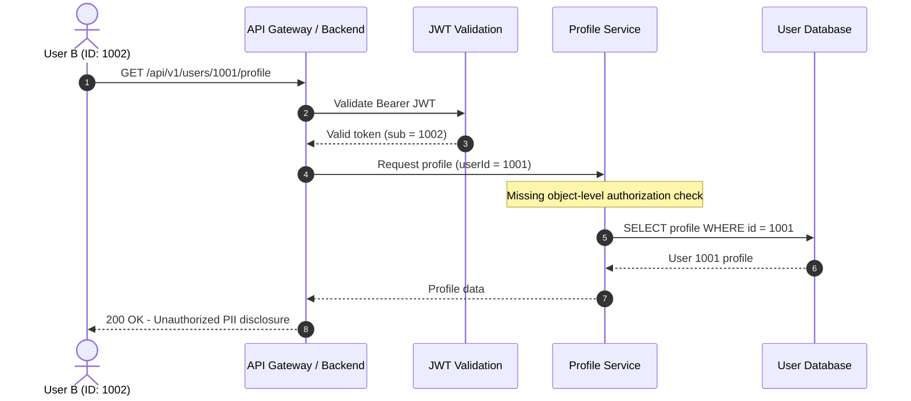

# Security Research Case Study
## Broken Object Level Authorization (BOLA / IDOR) in a User Profile API

**Category:** API Security  
**OWASP Classification:** API1:2023 – Broken Object Level Authorization  
**Assessment Type:** Authenticated API Security Testing  
**Technology Context:** REST API, JWT, Spring Boot, Relational Database  
**Severity:** High (Provisional – Subject to Business Impact Assessment)  
**Research Status:** Controlled Security Assessment / Demonstration Scenario

---

# 1. Executive Summary

During a controlled API security assessment, a Broken Object Level Authorization (BOLA) vulnerability was identified in an API endpoint responsible for retrieving user profile information.

The vulnerability occurs when an authenticated user can manipulate an object identifier in an API request to access another user's profile without the backend properly enforcing object-level authorization.

The application successfully validates the caller's authentication token but fails to verify whether the authenticated principal is authorized to access the requested resource.

As a result, an authenticated low-privileged user may retrieve sensitive Personally Identifiable Information (PII) belonging to other accounts.

Depending on the application's authorization model and exposed data, successful exploitation may result in:

- Unauthorized disclosure of personal information.
- Cross-account data exposure.
- Horizontal privilege escalation.
- Exposure of internal account attributes.
- Potential regulatory and privacy compliance violations.

The underlying issue is not a failure of authentication, but a failure of authorization enforcement at the object level.

# 2. Vulnerability Details

| Attribute | Description |
|---|---|
| Vulnerability Name | Broken Object Level Authorization |
| Alternative Name | Insecure Direct Object Reference (IDOR) |
| OWASP Classification | API1:2023 |
| Affected Component | User Profile API |
| HTTP Method | GET |
| Affected Endpoint | `/api/v1/users/{userId}/profile` |
| Authentication | JWT Bearer Token |
| Authorization | Improperly Enforced |
| Severity | High (Provisional) |
| Primary Impact | Unauthorized PII Disclosure |
| Attack Prerequisite | Valid authenticated user account |

**Potentially exposed information:**

- User ID
- Full name
- Email address
- Phone number
- Internal account attributes

*Note: This case study uses synthetic identifiers and fictional user information. No real customer data is represented.*

# 3. Scope and Security Assumptions

The assessment uses the following controlled environment assumptions.

### 3.1 User Accounts

Two authenticated accounts are available for testing:

| Account | User ID | Authorization Context |
|---|---|---|
| User A | 1001 | Standard user |
| User B | 1002 | Standard user |

Both accounts have valid authentication credentials and independently issued JWT access tokens.

### 3.2 Expected Authorization Behavior

The intended security policy is:

1. User A can access their own profile.
2. User B can access their own profile.
3. User A cannot access User B's private profile.
4. User B cannot access User A's private profile.
5. Administrative access must be explicitly authorized through the application's administrative permission model.

Authentication alone must not grant access to arbitrary user resources.

# 4. Technical Analysis

## 4.1 Vulnerability Description

The affected endpoint accepts a user identifier through the URL path:

`GET /api/v1/users/{userId}/profile`

The backend validates the JWT signature and extracts the authenticated principal.

However, the application does not enforce the necessary object-level authorization policy before returning the requested profile.

The vulnerable implementation effectively behaves as follows:

1. Validate the JWT.
2. Extract the requested user ID from the URL.
3. Query the database using the supplied identifier.
4. Return the corresponding profile without evaluating resource-level permissions.

This creates an authorization gap between the authenticated identity and the requested resource.

## 4.2 Attack Flow



**Security observation:**

The JWT is valid, but the requested resource belongs to another user.

The vulnerability exists because successful authentication is incorrectly treated as sufficient authorization to access the requested object.

# 5. Proof of Concept (PoC)

**Testing condition:** Use two authorized test accounts in a controlled environment. Do not use real customer identifiers or data.

## 5.1 Baseline Request – Accessing Own Profile

The attacker authenticates as User B (ID: 1002).

```http
GET /api/v1/users/1002/profile HTTP/1.1
Host: api.example.test
Authorization: Bearer <USER_B_ACCESS_TOKEN>
Accept: application/json
```

**Expected response:**

```http
HTTP/1.1 200 OK
Content-Type: application/json
```

```json
{
  "status": "success",
  "data": {
    "user_id": "1002",
    "full_name": "Test User B",
    "email": "user-b@example.test"
  }
}
```

This establishes the legitimate access baseline.

## 5.2 Authorization Boundary Test – Accessing Another User's Profile

Using the same authenticated session, the requested object identifier is changed to User A (ID: 1001).

```http
GET /api/v1/users/1001/profile HTTP/1.1
Host: api.example.test
Authorization: Bearer <USER_B_ACCESS_TOKEN>
Accept: application/json
```

**Vulnerable response:**

```http
HTTP/1.1 200 OK
Content-Type: application/json
```

```json
{
  "status": "success",
  "data": {
    "user_id": "1001",
    "full_name": "Test User A",
    "email": "user-a@example.test",
    "phone": "+620000000001",
    "account_type": "STANDARD"
  }
}
```

**Observed security failure:**

The API returns User A's private profile even though the request was authenticated using User B's access token.

The response demonstrates a cross-user authorization failure.

## 5.3 Expected Secure Behavior

The same cross-user request must be denied according to the application's resource disclosure policy.

For example:

```http
HTTP/1.1 403 Forbidden
Content-Type: application/json
```

```json
{
  "status": "error",
  "code": "ACCESS_DENIED",
  "message": "You are not authorized to access this resource."
}
```

A system may instead return `404 Not Found` to avoid disclosing whether another user's resource exists. Either response can be appropriate, provided unauthorized access is consistently prevented.

# 6. Root Cause Analysis

The primary root cause is the absence of object-level authorization enforcement within the application service layer.

The backend relies on a client-supplied resource identifier to retrieve database records without evaluating whether the authenticated principal has permission to access the requested object.

### 6.1 Technical Root Causes

| Root Cause | Security Consequence |
|---|---|
| Missing object-level authorization | Users can access unauthorized objects |
| Trust in client-supplied identifiers | Resource selection is not adequately controlled |
| Authentication and authorization are conflated | Valid tokens are incorrectly treated as unrestricted access |
| Insufficient tenant isolation | Potential cross-tenant data exposure |
| Missing authorization regression tests | Similar flaws may be reintroduced |

### 6.2 Important Security Distinction

JWT validation proves that the token is valid and identifies an authenticated principal.

It does not independently establish that the principal has permission to access every resource referenced in an API request.

Authorization must be evaluated against the requested resource, action, ownership, tenant context, and applicable business rules.

# 7. Remediation Strategy

## 7.1 Enforce Server-Side Object-Level Authorization

Implement authorization checks within the backend service layer.

Do not rely exclusively on frontend restrictions, hidden interface elements, or unpredictable resource identifiers.

The authorization decision should consider:

- Authenticated principal.
- Requested resource.
- Requested operation.
- Resource ownership.
- Tenant or organization membership.
- Explicit permissions and applicable business rules.

## 7.2 Spring Boot Implementation Example

The following example demonstrates a resource-scoped repository query.

It assumes that the application has already validated the JWT and populated a trusted authentication principal.

**Repository:**

```java
public interface UserProfileRepository
        extends JpaRepository<UserProfile, UUID> {

    Optional<UserProfile> findByIdAndTenantId(
        UUID userId,
        UUID tenantId
    );
}
```

**Service Layer:**

```java
@Service
@RequiredArgsConstructor
public class UserProfileService {

    private final UserProfileRepository repository;
    private final ProfileMapper profileMapper;
    private final ProfileAuthorizationService authorizationService;

    @Transactional(readOnly = true)
    public UserProfileResponse getProfile(
            UUID requestedUserId,
            UserPrincipal principal) {

        UserProfile profile = repository
            .findByIdAndTenantId(
                requestedUserId,
                principal.getTenantId()
            )
            .orElseThrow(ResourceNotFoundException::new);

        if (!authorizationService.canReadProfile(
                principal, profile)) {

            throw new AccessDeniedException(
                "Access denied"
            );
        }

        return profileMapper.toAuthorizedResponse(
            principal, profile
        );
    }
}
```

**Authorization Policy Service:**

```java
@Service
public class ProfileAuthorizationService {

    public boolean canReadProfile(
            UserPrincipal principal,
            UserProfile profile) {

        if (principal == null || profile == null) {
            return false;
        }

        if (!principal.getTenantId()
                .equals(profile.getTenantId())) {
            return false;
        }

        if (principal.getUserId()
                .equals(profile.getOwnerId())) {
            return true;
        }

        return principal.hasAuthority(
            "profile:read:any"
        );
    }
}
```

**Implementation considerations:**

- `UserPrincipal` must originate from a trusted authentication context, not request-controlled fields.
- `tenantId` must be derived from validated identity and trusted membership context.
- Administrative permissions must be explicitly granted and appropriately scoped.
- Repository-level tenant filtering provides an additional isolation boundary.
- Response DTOs must expose only properties authorized for the requesting principal.
- Authorization policies should be consistently applied to every relevant operation.

This example illustrates a basic tenant-scoped policy. Production systems may require more complex RBAC, ABAC, or relationship-based authorization rules.

## 7.3 Use Unpredictable Resource Identifiers as Defense in Depth

Consider using UUIDs instead of sequential database identifiers where appropriate.

Example:

```text
/api/v1/users/550e8400-e29b-41d4-a716-446655440000/profile
```

UUIDs can reduce identifier predictability and casual enumeration.

However:

**UUIDs do not prevent BOLA.**

An attacker who obtains a valid identifier may still access the resource if authorization is missing.

Object-level authorization remains mandatory regardless of identifier format.

## 7.4 Implement Property-Level Authorization

Apply explicit response DTOs and field-level authorization policies.

For example:

```java
public record UserProfileResponse(
    UUID userId,
    String fullName,
    String email
) {}
```

Do not automatically serialize database entities containing sensitive internal attributes.

Fields such as internal roles, administrative flags, security metadata, and private contact information must not be exposed merely because they exist in the database entity.

This is also relevant to OWASP API3:2023 – Broken Object Property Level Authorization.

## 7.5 Implement Authorization Logging and Monitoring

Record relevant authorization failures without exposing sensitive information.

Recommended security events:

- Unauthorized cross-user access attempts.
- Cross-tenant resource access attempts.
- Repeated authorization failures.
- Attempts to access administrative resources.
- Unusual resource access patterns.

Recommended log attributes:

- Timestamp.
- Request correlation ID.
- Authenticated principal identifier.
- Tenant identifier, where applicable.
- Requested resource type.
- Requested operation.
- Authorization decision.
- Response status.

Never log access tokens, passwords, or unnecessary PII.

# 8. Security Validation and Regression Testing

A remediation is not complete until the authorization policy has been tested.

The following matrix provides a baseline for validation.

| Test Scenario | Expected Result |
|---|---|
| User accesses own profile | 200 OK |
| User accesses another user's private profile | 403 / 404 |
| User accesses another tenant's profile | 403 / 404 |
| Unauthenticated request | 401 Unauthorized |
| Expired access token | 401 Unauthorized |
| Invalid JWT signature | 401 Unauthorized |
| User with explicit profile-read permission | Allowed within policy scope |
| User with unrelated administrative role | Denied |
| Response contains unauthorized properties | Denied or filtered |

### 8.1 Automated Authorization Tests

Example using JUnit and Spring Security Test:

```java
@Test
@WithMockUser(username = "user-1002")
void shouldRejectAccessToAnotherUsersProfile() {

    UUID victimId = UUID.randomUUID();

    assertThrows(
        AccessDeniedException.class,
        () -> profileService.getProfile(
            victimId,
            attackerPrincipal
        )
    );
}
```

The test fixture must configure an attacker principal, victim resource, and tenant context that accurately reflect the authorization policy.

Additional tests should cover:

- Horizontal access control.
- Vertical privilege escalation.
- Cross-tenant isolation.
- Property-level access.
- Read, update, and delete operations.
- Administrative permission boundaries.
- Authorization behavior across API versions.

# 9. Security Impact Assessment

### Confidentiality

Unauthorized users may retrieve private profile information belonging to other accounts.

### Integrity

If equivalent authorization flaws exist in update operations, attackers may modify another user's profile information.

### Availability

If similar weaknesses affect account-management or deletion endpoints, unauthorized actions may disrupt user accounts or services.

### Business Impact

Potential consequences include:

- Personal data exposure.
- Loss of customer trust.
- Privacy and regulatory compliance risks.
- Incident response and remediation costs.
- Reputational damage.

**Severity Assessment: High (Provisional)**

The final severity should be determined using verified exploitability, exposed data sensitivity, attack prerequisites, affected users, business impact, and an appropriate CVSS assessment.

# 10. Security Recommendations

| Priority | Recommendation |
|---|---|
| Critical | Enforce object-level authorization on every resource operation |
| High | Implement tenant isolation at the service and data-access layers |
| High | Introduce centralized authorization policies |
| High | Implement property-level response filtering |
| High | Add automated authorization regression tests |
| Medium | Use unpredictable resource identifiers as defense in depth |
| Medium | Implement authorization monitoring and alerting |
| Medium | Conduct periodic API access-control assessments |

# 11. Conclusion

This case study demonstrates how a seemingly minor authorization omission can expose sensitive user information through an authenticated API.

The presence of a valid JWT does not guarantee that a user is authorized to access every object within an application.

Modern API security requires authorization decisions to be enforced at the resource level and consistently applied across all relevant application operations.

The most important security principle is:

**Every request must be authorized against the specific resource and action being performed, not merely authenticated against the application.**

BOLA prevention must therefore be treated as a core application security requirement rather than an optional enhancement.

---

# 12. References and Technical Standards

1. OWASP API Security Top 10 – API1:2023 Broken Object Level Authorization  
   https://owasp.org/API-Security/editions/2023/en/0xa1-broken-object-level-authorization/

2. OWASP API Security Top 10 – API3:2023 Broken Object Property Level Authorization  
   https://owasp.org/API-Security/editions/2023/en/0xa3-broken-object-property-level-authorization/

3. OWASP Authorization Cheat Sheet  
   https://cheatsheetseries.owasp.org/cheatsheets/Authorization_Cheat_Sheet.html

4. OWASP API Security Project  
   https://owasp.org/www-project-api-security/

5. Spring Security – Method Security Documentation  
   https://docs.spring.io/spring-security/reference/servlet/authorization/method-security.html

6. OWASP DevSecOps Guideline – API Security  
   https://owasp.github.io/DevSecOpsGuideline/current-version/2-Process/2-4-Test/2-4-4-API-Security/

---

**Document Classification:** Security Research / Technical Portfolio  
**Research Domain:** Web Application Security | API Security | Access Control  
**Assessment Environment:** Controlled Testing Environment  
**Data Classification:** Synthetic Demonstration Data

**Portfolio Integrity Notice:** This document describes a controlled demonstration scenario. Replace illustrative observations, test results, and severity assumptions with verified evidence from an authorized assessment before presenting it as a real-world vulnerability discovery.