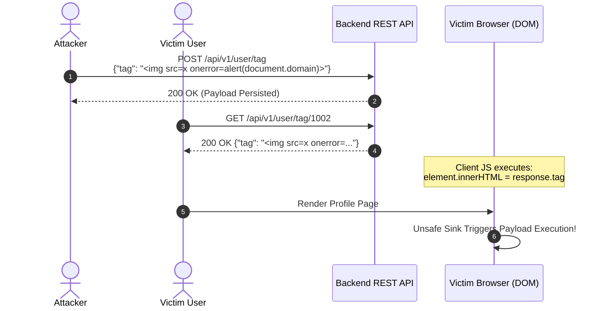

# Case Study: Stored DOM-Based Cross-Site Scripting (XSS) via Unsafe Sink Rendering


## Executive Summary
A Stored DOM-based Cross-Site Scripting (XSS) vulnerability was identified in the user profile custom tag feature. An attacker could inject malicious JavaScript payloads into an input field, which is stored server-side and subsequently executed in the context of any victim's browser session upon rendering the dynamically fetched data via an unsafe JavaScript sink.


---


## Vulnerability Details
- **Vulnerability Type:** Stored DOM-based Cross-Site Scripting (OWASP Top 10 - A03:2021 Injection)
- **Severity:** High
- **Affected Component:** Client-side Profile Renderer (innerHTML sink)
- **Impact:** Session Hijacking via Cookie/Storage Exfiltration, Impersonation, Unauthorized Actions
---


## Technical Analysis & Attack Flow


1. **Storage Phase:** The application accepts unencoded HTML entities in the name_tag input parameter and persists it into the database.
2. **Execution Phase:** When a victim views the affected profile, the application fetches the payload via an API response and dynamically injects it into the DOM using innerHTML without sanitization.



---


## Proof of Concept (PoC)


### 1. Injected Request (Payload Persistence):
```http
POST /api/v1/user/tag HTTP/1.1
Host: target-app.com
Authorization: Bearer <Attacker_JWT>
Content-Type: application/json


{
  "name_tag": ""
}
```

### 2. Vulnerable Client-Side JavaScript Code:
```javascript
// Dangerous sink: Direct assignment to innerHTML without sanitization
fetch('/api/v1/user/tag/1002')
  .then(response => response.json())
  .then(data => {
    document.getElementById('user-tag-display').innerHTML = data.name_tag; // VULNERABLE SINK
  });
```

---


## Root Cause Analysis
The vulnerability exists due to a dual failure:
1. **Lack of Context-Aware Sanitization:** The frontend framework directly passes untrusted user input from an asynchronous REST response into a dangerous DOM execution sink (innerHTML).
2. **Missing Content Security Policy (CSP):** The application lacks restrictive HTTP headers to block inline script execution or restrict unauthorized out-of-band data exfiltration.


---


## Remediation Strategy


### 1. Safe Client-Side Rendering (DOM Sanitization)
Replace dangerous sinks with text-node assignments (textContent) or sanitize input using robust libraries like DOMPurify before rendering:


```javascript
// Remediation Option A: Use textContent (Safe against HTML injection)
document.getElementById('user-tag-display').textContent = data.name_tag;


// Remediation Option B: Sanitize with DOMPurify if HTML rendering is required
import DOMPurify from 'dompurify';
document.getElementById('user-tag-display').innerHTML = DOMPurify.sanitize(data.name_tag);
```

### 2. Implement Restrictive Content Security Policy (CSP)
Configure strong security headers on the server to mitigate XSS payload execution:


```http
Content-Security-Policy: default-src 'self'; script-src 'self'; object-src 'none';
```